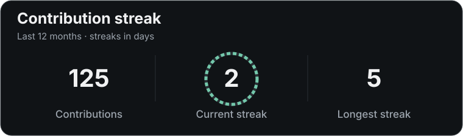
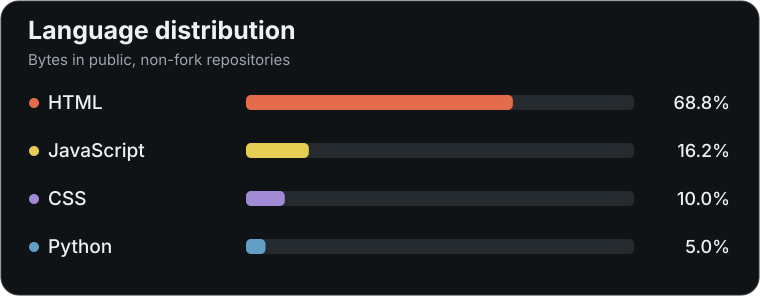

<h1 align="center">Hey 👨‍💻 I'm Kádár Apor</h1>

  

## 📌 About Me

I'm an independent full-stack developer based in Romania, focused on building custom websites, interactive experiences and web applications.

I work across design, frontend development, backend development and deployment.

- 🌐 Portfolio: [aporka.dev](https://www.aporka.dev/)
- 📫 Contact: contact@aporka.dev
- 🚀 Currently building [Bookliva](https://bookliva.tech/)

## 📊 GitHub Stats & Trophies

  

  

  

  

## 🛠️ Languages & Tools

> ### Programming Languages

  

> ### Frontend

  

React · Next.js · GSAP · HTML · CSS

> ### Backend

  

> ### Database

  

> ### Deployment

  

> ### Tools

  

## Selected Work

- **[Kádár Energy](https://www.kadar-energy.ro/)** — Client website redesign featuring an interactive 3D experience.
- **[Meleg András PFA](https://meleg-andras.ro/)** — Custom website for a surveying business.
- **[Vesper](https://vesper.aporka.dev/)** — Interactive smart home website with cinematic animations.
- **[Bookliva](https://bookliva.tech/)** — Direct reservation system for independent hotels.
- **[please.](https://please.aporka.dev/)** — A collection of ten everyday web applications.
- **[Tamás Bistro](https://tamas-bistro.vercel.app/)** — Vintage-inspired restaurant website redesign concept.

## 🔗 Connect with Me

  
  

  <a href="https://www.aporka.dev/">Portfolio</a>
  ·
  <a href="https://peerlist.io/aporka">Peerlist</a>
  ·
  <a href="mailto:contact@aporka.dev">Email</a>

---

  Kádár Apor ·
  Inspired by the creative dev template by @himanshu201031

