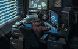
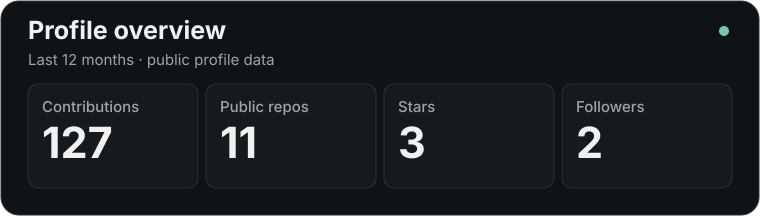
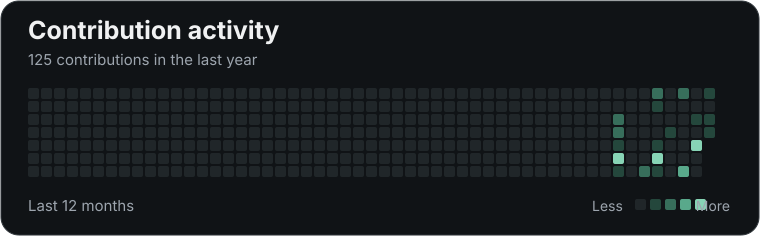
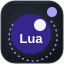
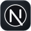
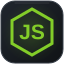
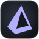
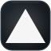
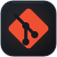

<h1 align="left">Kádár Apor</h1>

  

Independent full-stack web developer from Romania.

I design and build custom websites and web applications, with a focus on clean UI, creative frontend development and practical full-stack products.

  <a href="https://www.aporka.dev/">Portfolio</a> ·
  <a href="mailto:contact@aporka.dev">Email</a> ·
  <a href="https://www.linkedin.com/in/apor-k%C3%A1d%C3%A1r-89a346448/">LinkedIn</a> ·
  <a href="https://peerlist.io/aporka">Peerlist</a>

   <strong>Contact:</strong> <a href="mailto:contact@aporka.dev">contact@aporka.dev</a>

   <strong>Currently building:</strong> <a href="https://bookliva.tech/">Bookliva</a>

##  GitHub Stats & Trophies

  
  

  

  

##  Languages & Tools

### Programming Languages

  
  
  
  

### Frontend

  
  
  
  
  

### Backend

  
  
  

### Database

  
  
  
  

### Deployment

  
  

### Tools

  
  
  
  

##  Featured Projects

- **[Kádár Energy](https://www.kadar-energy.ro/)** — Client website redesign featuring an interactive 3D experience.
- **[Meleg András PFA](https://meleg-andras.ro/)** — Custom website for a surveying business.
- **[Vesper](https://vesper.aporka.dev/)** — Interactive smart home website with cinematic animations.
- **[Bookliva](https://bookliva.tech/)** — Direct reservation system for independent hotels.
- **[please.](https://please.aporka.dev/)** — A collection of ten everyday web applications.
- **[Tamás Bistro](https://tamas-bistro.vercel.app/)** — Vintage-inspired restaurant website redesign concept.

##  Connect with Me

  
  

  <a href="https://www.aporka.dev/">Portfolio</a> · <a href="https://peerlist.io/aporka">Peerlist</a>

